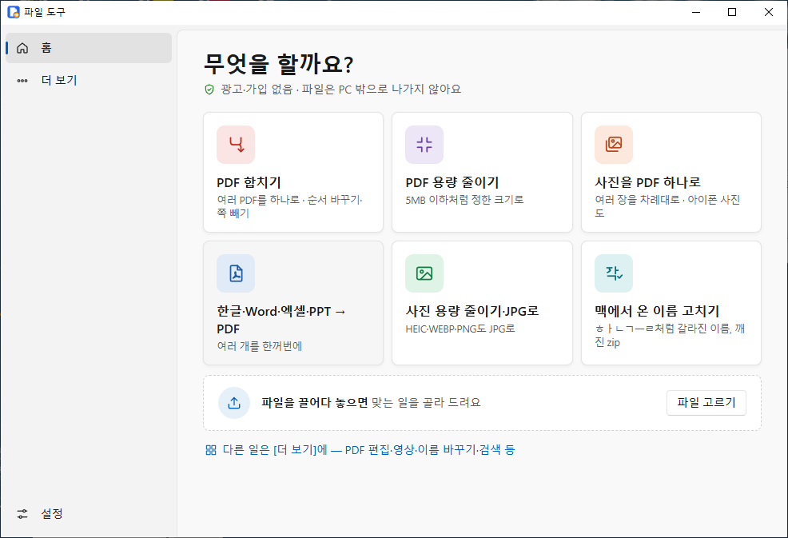
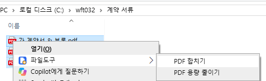
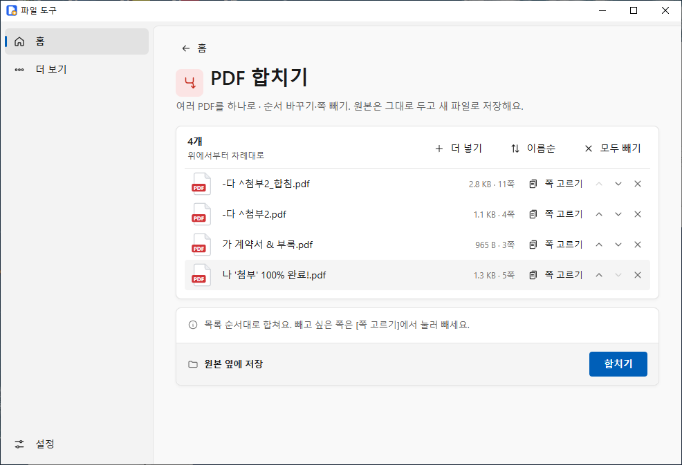
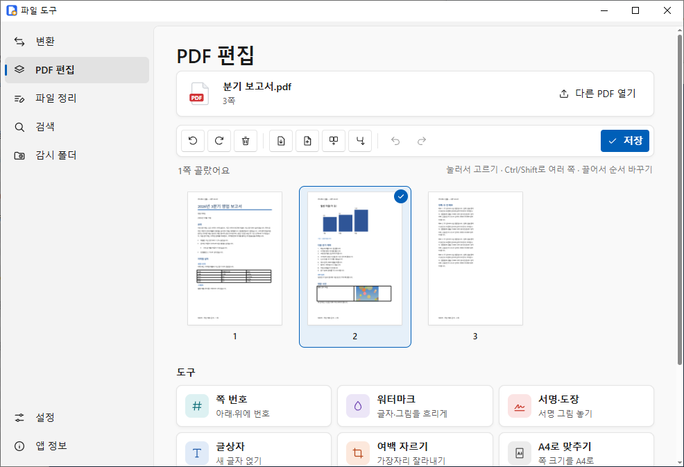
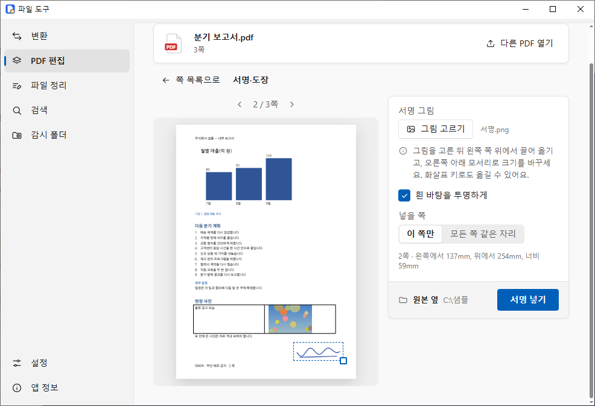
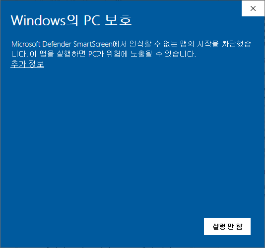
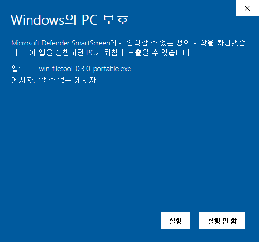

# 파일 도구 (win-filetool)

Windows에서 자주 하는 파일 일 6가지를 **빠르고 확실하게** 하는 무료 프로그램입니다. 광고·가입이 없고, 파일은 PC 밖으로 나가지 않습니다.
**원본은 그대로 두고** 결과는 원본 옆에 새 이름으로 저장합니다.

## 이 6가지를 합니다

| 할 일 | 이렇게 해요 |
|---|---|
| **PDF 합치기** | 여러 PDF를 하나로. 같은 화면에서 순서를 바꾸고 필요 없는 쪽은 눌러서 뺍니다. |
| **PDF 용량 줄이기** | "5MB 이하"처럼 목표 크기를 고르면 그 아래가 될 때까지 사진만 줄입니다(글자·선은 그대로). 안 되면 가장 작게 만든 것과 얼마나 줄었는지 알려 줍니다. |
| **사진을 PDF 하나로** | 여러 장을 차례대로 한 PDF에. A4에 맞추기, 아이폰 사진(HEIC)도 됩니다. |
| **한글·Word·엑셀·PPT → PDF** | 여러 개를 한꺼번에. 한글 파일은 PC에 한글이 있으면 한글로 바꿔 모양이 같습니다. |
| **사진 용량 줄이기·JPG로** | HEIC·WEBP·PNG를 JPG로 바꾸고 크기를 줄입니다(촬영 날짜는 남김). |
| **맥에서 온 이름 고치기** | `ㅎㅏㄴㄱㅡㄹ`처럼 갈라진 파일·폴더 이름, 한글이 깨진 zip을 바로잡습니다. |

- **우클릭 메뉴**: 탐색기에서 파일을 고르고 우클릭 → **파일도구** → 고른 파일에 맞는 일만 나옵니다. 여러 파일을 골라도 한 번에 들어옵니다.
  Windows 11에서는 "더 많은 옵션 표시" 안에 있습니다(Shift+우클릭이면 바로). 설치본은 처음부터 켜져 있고, 설치 없는 exe는 [설정] → **우클릭 메뉴**로 켜고 끕니다.
- **끌어다 놓기**: 첫 화면에 파일을 놓으면 맞는 일을 골라 보여 줍니다. 여러 개를 할 때 하나가 안 돼도 끝까지 하고 "10개 중 9개 완료, 1개는 암호가 걸려 있어요"처럼 알려 줍니다.
- **더 보기**: 그 밖의 기능도 모두 그대로 있습니다 — Word→PPT, PDF→Word, PDF 쪽 편집·서명·쪽 번호·워터마크·암호, 사진 자르기·정보 지우기,
  영상 줄이기·자르기, 이름 한꺼번에 바꾸기, 같은 파일 찾기, zip, 파일 이름 검색(초성도 됨, [docs/SEARCH.md](docs/SEARCH.md)), 감시 폴더.

| 우클릭 메뉴 | PDF 합치기 |
|---|---|
|  |  |
| **PDF 편집(더 보기)** | **서명 넣기(더 보기)** |
|  |  |

## 다운로드

**[최신 판 받기 → github.com/salarycrew/win-filetool/releases/latest](https://github.com/salarycrew/win-filetool/releases/latest)**

| 파일 | 이런 분께 |
|---|---|
| `win-filetool-<버전>-portable.exe` | **설치 없이 받아서 바로 실행.** 대부분 이것이면 됩니다. exe 하나라 USB에 넣고 다녀도 됩니다. 우클릭 메뉴는 [설정]에서 켭니다. |
| `win-filetool-<버전>-setup.exe` (설치 파일) | 빠른 검색 서비스·윈도 시작 시 자동 실행이 필요한 분. 시작 메뉴에 "파일 도구"가 생기고 우클릭 메뉴가 처음부터 켜집니다. 관리자 권한 없이 설치됩니다. |

- Windows 10·11 64비트용입니다. 처음 문서를 바꿀 때 "문서 도구 준비 중(약 3초)"이 한 번 나옵니다(앱에 든 도구를 이 PC에 풉니다).
- 받은 파일이 맞는지 확인하려면 같은 곳의 `SHA256SUMS.txt`와 비교하세요(PowerShell: `Get-FileHash 파일이름`).

### 처음 실행할 때 "Windows의 PC 보호" 창이 뜨면

이 프로그램은 유료 코드 서명 인증서로 서명하지 않아서, 인터넷에서 받은 exe를 처음 열면 Windows가 아래처럼 막을 수 있습니다.

1. **[추가 정보]** 를 누릅니다.

   

2. 게시자가 "알 수 없는 게시자"로 나오고 **[실행]** 단추가 생깁니다. **[실행]** 을 누르면 열립니다. 한 번 실행하면 다음부터는 묻지 않습니다.

   

받은 곳이 위 GitHub 주소가 맞는지 먼저 확인하세요. 다른 곳에서 받은 파일은 실행하지 마세요.

## 파일은 PC 밖으로 나가지 않아요

- 변환·편집·검색은 모두 이 PC 안에서 합니다. 앱에는 인터넷으로 파일이나 정보를 보내는 기능이 없습니다(자동 업데이트·사용 통계도 없음).
- 인터넷에 묻는 것은 하나뿐입니다: 새 버전이 나왔는지 하루 한 번까지 GitHub에서 **최신 버전 번호만** 확인합니다(파일·개인 정보는 보내지 않음, 받기·설치도 하지 않음). 끄려면 [설정] → **새 버전 나오면 알려 주기**를 끄세요.
- 앱 안에 보이는 주소는 세 가지뿐입니다: 화면 구성 요소(WebView2)가 없는 PC에서 보여 주는 Microsoft 내려받기 주소, [앱 정보]의 오픈소스 소스 주소(글자로만 표시·복사), 새 버전 알림의 [받으러 가기](이 GitHub 릴리스 쪽을 브라우저로 엶).
- 결과는 원본 옆에 새 이름(`이름_압축.pdf`, 같은 이름이 있으면 `이름 (1)`)으로 저장합니다. 원본을 덮어쓰지 않습니다.

## 한글(HWP) 파일

- **한글(한컴오피스)이 설치된 PC**: 설치된 한글로 PDF·PPT를 만들어 모양이 원본과 같습니다. 변환하는 동안에만 한글을 창 없이 잠깐 씁니다.
- **한글이 없는 PC**: 오래된 한글 97 문서만 PDF·PPT로 바꿀 수 있고, 2002년 이후 형식(.hwp·.hwpx)은 **그림만 뽑기**를 쓸 수 있습니다. 화면에 되는 일만 나옵니다.
- **암호가 걸린 한글 파일**은 바꿀 수 없습니다. 한글에서 암호를 풀고 다시 넣어 주세요. **배포용 한글 파일**은 한글이 설치된 PC에서 PDF로만 바꿀 수 있습니다(만든 사람이 인쇄를 막아 두었으면 안 됨).
- 제목 스타일이 없는 한글 문서도 PPT로 바꿀 때 큰 글자·굵은 짧은 줄·번호(Ⅰ., 1., 가.)를 제목으로 보고 여러 장으로 나눕니다.

## 빠른 검색 서비스 (선택)

- 앱만으로도 검색이 됩니다. [설정] → **빠른 검색 서비스 설치**를 누르면(관리자 확인 창 1번) C 드라이브 전체를 훨씬 빨리 찾고 바뀐 것도 바로 반영합니다.
- 서비스는 파일 **이름 목록**만 답하고 파일을 열거나 바꾸지 않습니다. 다른 사용자의 개인 폴더는 결과에서 뺍니다. 다른 PC에서는 연결할 수 없습니다.
- 새 판으로 바꾸면 [설정]에 **다시 설치(갱신)** 가 나옵니다. 지우려면 [설정] → 제거(관리자 확인 1번), 또는 앱을 지울 때 함께 지우기를 고르세요.

## 지우기 · 설정이 있는 곳

- 설치본: [Windows 설정 > 앱 > 설치된 앱]에서 "파일 도구" 제거(우클릭 메뉴도 함께 지워짐). 설정 폴더는 제거 화면에서 "앱 데이터 삭제"를 고를 때만 지웁니다.
- 설치 없는 exe: 우클릭 메뉴를 켰다면 먼저 [설정] → **우클릭 메뉴**를 끄고 exe를 지우면 됩니다(메뉴는 `HKCU\Software\Classes` 아래 사용자 등록값이라 관리자 권한이 필요 없습니다). exe 옆에 `win-filetool-data` 폴더를 만들어 두면 설정을 그 안에 둡니다(USB용).
- 설정 `%APPDATA%\kr.salarycrew.winfiletool\`, 검색 색인·앱에 든 도구 `%LOCALAPPDATA%\kr.salarycrew.winfiletool\`(지워도 됨, 필요하면 다시 만듦).

## 라이선스

- 파일 도구의 코드는 **MIT 라이선스**입니다([LICENSE](LICENSE)). 출처(저작권 표시)를 밝히면 누구나 고치고 다시 쓸 수 있습니다.
- 앱에는 ffmpeg(LGPL)·LibreOffice(MPL)·PDFium(BSD) 같은 오픈소스 부품이 들어 있습니다. 무엇이 들었고 어떤 라이선스인지는 [THIRD_PARTY.md](THIRD_PARTY.md),
  전문은 앱의 [앱 정보] → 오픈소스 고지(또는 함께 받는 `THIRD-PARTY-NOTICES.txt`)에 있습니다.
- LGPL·MPL 부품의 정확한 소스: <https://github.com/salarycrew/win-filetool-sources>

## 문제 신고

잘 안 되는 것이 있으면 [GitHub Issues](https://github.com/salarycrew/win-filetool/issues)에 알려 주세요. 오류 화면의 **[자세히]** 내용과
[앱 정보]의 버전을 함께 적어 주시면 빨리 고칠 수 있습니다. 개인 파일은 올리지 마세요.

---

만드는 법(개발자용)은 [docs/BUILD.md](docs/BUILD.md), 설계 기록은 [docs/design.md](docs/design.md), 바뀐 점은 [CHANGELOG.md](CHANGELOG.md)에 있습니다.
