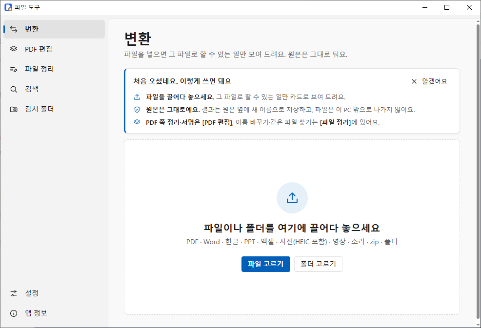
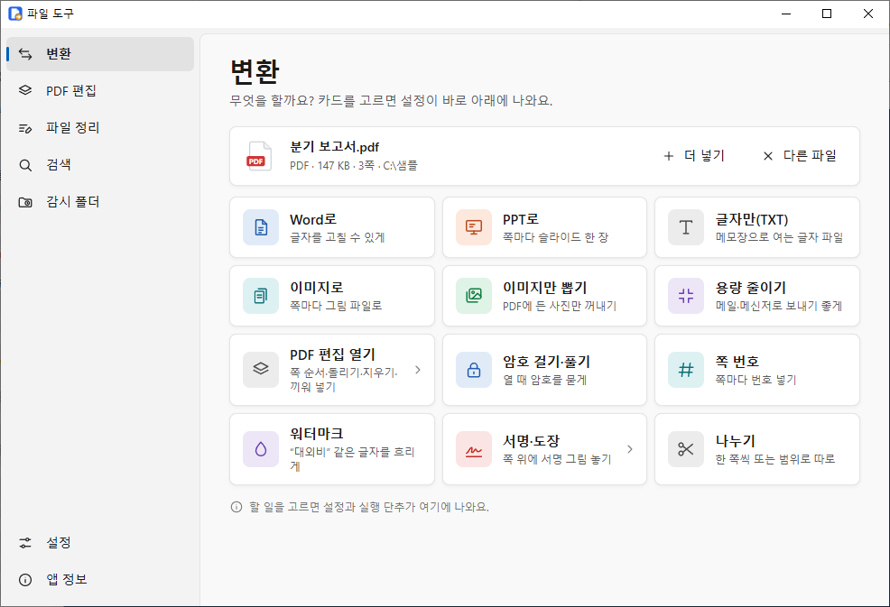
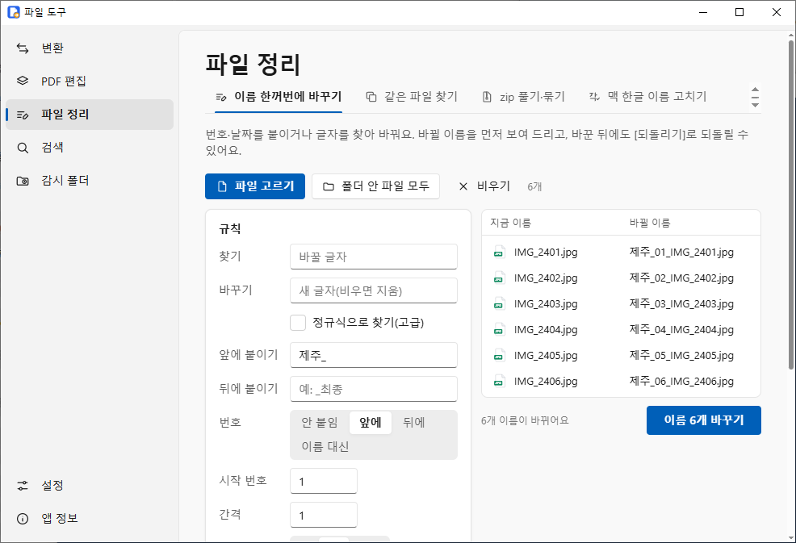
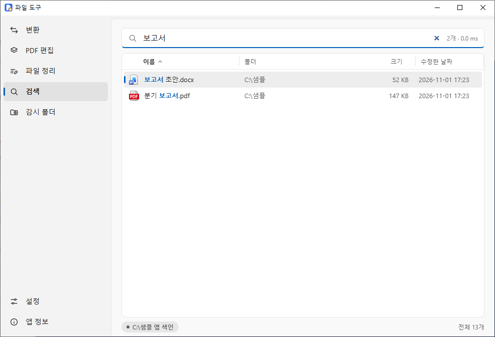

# 파일 도구 (win-filetool)

Windows에서 자주 하는 파일 일을 한곳에서 하는 무료 프로그램입니다. 파일을 끌어다 놓으면 그 파일로 할 수 있는 일만 보여 줍니다.
**원본은 그대로 두고** 결과는 원본 옆에 새 이름으로 저장합니다. 모든 일은 이 PC 안에서 하고, 파일을 인터넷으로 보내지 않습니다.

## 할 수 있는 일

- **문서 바꾸기**: Word·엑셀·파워포인트·한글·맥(Pages·Numbers·Keynote) 문서를 PDF로. Word를 PPT로(제목마다 한 장), PDF를 Word·PPT·글자(TXT)로.
  문서에 든 그림만 뽑기(Word·PPT·엑셀·PDF·한글).
- **PDF 편집**: 쪽 그림을 보면서 끌어서 순서 바꾸기, 돌리기, 지우기, 고른 쪽만 새 PDF로 뽑기, 빈 쪽·다른 PDF 끼워 넣기, 합치기·나누기.
  쪽 번호, 워터마크(글자·그림), 서명·도장 그림 넣기, 글상자 얹기, 여백 자르기, A4로 맞추기, 2쪽·4쪽 모아 한 장에, 암호 걸기·풀기,
  문서 정보(작성자) 지우기, 양식(빈칸) 채우기, 평평하게 굳히기, 용량 줄이기, 쪽마다 그림으로.
- **사진**: 형식 바꾸기(아이폰 HEIC → JPG 포함), 크기·용량 맞추기, 자르기·돌리기·뒤집기, 위치·촬영 정보 지우기(남에게 보내기 전), 여러 장을 PDF 하나로.
- **영상·소리**: MP4로, 메신저로 보낼 크기로 줄이기, 앞뒤 자르기, 소리 빼기, 돌리기, 화면 한 장 JPG로, 짧은 GIF, 소리만 MP3·M4A로.
- **파일 정리**: 이름 한꺼번에 바꾸기(번호·날짜·찾아 바꾸기, 미리 보고 적용, 되돌리기), 내용이 같은 파일 찾기, zip 풀기·묶기(이름이 깨진 zip도),
  맥에서 온 한글 파일 이름 고치기.
- **검색**: 모든 드라이브의 파일 이름을 치는 대로 바로 찾습니다(한글 초성 `ㅂㄱㅅ`도 됨). 검색 문법은 [docs/SEARCH.md](docs/SEARCH.md).
- **감시 폴더**: 정해 둔 폴더에 들어온 파일을 자동으로 바꿉니다(예: 아이폰 사진 → JPG).

| PDF 편집 | 서명 넣기 |
|---|---|
|  |  |
| **PDF로 할 수 있는 일** | **이름 한꺼번에 바꾸기** |
|  |  |
| **검색** | |
|  | |

## 다운로드

**[최신 판 받기 → github.com/salarycrew/win-filetool/releases/latest](https://github.com/salarycrew/win-filetool/releases/latest)**

| 파일 | 이런 분께 |
|---|---|
| `win-filetool-<버전>-setup.exe` (설치 파일) | **대부분 이것을 고르세요.** 시작 메뉴에 "파일 도구"가 생기고, 빠른 검색 서비스를 쓸 수 있습니다. 관리자 권한 없이 설치됩니다. |
| `win-filetool-<버전>-portable.exe` (설치 없는 exe) | 설치하지 않고 바로 쓰거나 USB에 넣고 다닐 때. exe 하나만 있으면 됩니다. |

- Windows 10·11 64비트용입니다. 처음 문서를 바꿀 때 "문서 도구 준비 중(약 3초)"이 한 번 나옵니다(앱에 든 도구를 이 PC에 풉니다).
- 받은 파일이 맞는지 확인하려면 같은 곳의 `SHA256SUMS.txt`와 비교하세요(PowerShell: `Get-FileHash 파일이름`).

### 처음 실행할 때 "Windows의 PC 보호" 창이 뜨면

이 프로그램은 유료 코드 서명 인증서로 서명하지 않아서, 인터넷에서 받은 exe를 처음 열면 Windows가 아래처럼 막을 수 있습니다.

1. **[추가 정보]** 를 누릅니다.

   

2. 게시자가 "알 수 없는 게시자"로 나오고 **[실행]** 단추가 생깁니다. **[실행]** 을 누르면 열립니다. 한 번 실행하면 다음부터는 묻지 않습니다.

   

받은 곳이 위 GitHub 주소가 맞는지 먼저 확인하세요. 다른 곳에서 받은 파일은 실행하지 마세요.

## 파일은 PC 밖으로 나가지 않아요

- 변환·편집·검색은 모두 이 PC 안에서 합니다. 앱에는 인터넷으로 파일이나 정보를 보내는 기능이 없습니다(자동 업데이트·사용 통계도 없음).
- 인터넷에 묻는 것은 하나뿐입니다: 새 버전이 나왔는지 하루 한 번까지 GitHub에서 **최신 버전 번호만** 확인합니다(파일·개인 정보는 보내지 않음, 받기·설치도 하지 않음). 끄려면 [설정] → **새 버전 나오면 알려 주기**를 끄세요.
- 앱 안에 보이는 주소는 세 가지뿐입니다: 화면 구성 요소(WebView2)가 없는 PC에서 보여 주는 Microsoft 내려받기 주소, [앱 정보]의 오픈소스 소스 주소(글자로만 표시·복사), 새 버전 알림의 [받으러 가기](이 GitHub 릴리스 쪽을 브라우저로 엶).
- 결과는 원본 옆에 새 이름(`이름_압축.pdf`, 같은 이름이 있으면 `이름 (1)`)으로 저장합니다. 원본을 덮어쓰지 않습니다.

## 한글(HWP) 파일

- **한글(한컴오피스)이 설치된 PC**: 설치된 한글로 PDF·PPT를 만들어 모양이 원본과 같습니다. 변환하는 동안에만 한글을 창 없이 잠깐 씁니다.
- **한글이 없는 PC**: 오래된 한글 97 문서만 PDF·PPT로 바꿀 수 있고, 2002년 이후 형식(.hwp·.hwpx)은 **그림만 뽑기**를 쓸 수 있습니다. 화면에 되는 일만 나옵니다.
- **암호가 걸린 한글 파일**은 바꿀 수 없습니다. 한글에서 암호를 풀고 다시 넣어 주세요. **배포용 한글 파일**은 한글이 설치된 PC에서 PDF로만 바꿀 수 있습니다(만든 사람이 인쇄를 막아 두었으면 안 됨).
- 제목 스타일이 없는 한글 문서도 PPT로 바꿀 때 큰 글자·굵은 짧은 줄·번호(Ⅰ., 1., 가.)를 제목으로 보고 여러 장으로 나눕니다.

## 빠른 검색 서비스 (선택)

- 앱만으로도 검색이 됩니다. [설정] → **빠른 검색 서비스 설치**를 누르면(관리자 확인 창 1번) C 드라이브 전체를 훨씬 빨리 찾고 바뀐 것도 바로 반영합니다.
- 서비스는 파일 **이름 목록**만 답하고 파일을 열거나 바꾸지 않습니다. 다른 사용자의 개인 폴더는 결과에서 뺍니다. 다른 PC에서는 연결할 수 없습니다.
- 새 판으로 바꾸면 [설정]에 **다시 설치(갱신)** 가 나옵니다. 지우려면 [설정] → 제거(관리자 확인 1번), 또는 앱을 지울 때 함께 지우기를 고르세요.

## 지우기 · 설정이 있는 곳

- 설치본: [Windows 설정 > 앱 > 설치된 앱]에서 "파일 도구" 제거. 설정 폴더는 제거 화면에서 "앱 데이터 삭제"를 고를 때만 지웁니다.
- 설치 없는 exe: exe를 지우면 됩니다. exe 옆에 `win-filetool-data` 폴더를 만들어 두면 설정을 그 안에 둡니다(USB용).
- 설정 `%APPDATA%\kr.salarycrew.winfiletool\`, 검색 색인·앱에 든 도구 `%LOCALAPPDATA%\kr.salarycrew.winfiletool\`(지워도 됨, 필요하면 다시 만듦).

## 라이선스

- 파일 도구의 코드는 **MIT 라이선스**입니다([LICENSE](LICENSE)). 출처(저작권 표시)를 밝히면 누구나 고치고 다시 쓸 수 있습니다.
- 앱에는 ffmpeg(LGPL)·LibreOffice(MPL)·PDFium(BSD) 같은 오픈소스 부품이 들어 있습니다. 무엇이 들었고 어떤 라이선스인지는 [THIRD_PARTY.md](THIRD_PARTY.md),
  전문은 앱의 [앱 정보] → 오픈소스 고지(또는 함께 받는 `THIRD-PARTY-NOTICES.txt`)에 있습니다.
- LGPL·MPL 부품의 정확한 소스: <https://github.com/salarycrew/win-filetool-sources>

## 문제 신고

잘 안 되는 것이 있으면 [GitHub Issues](https://github.com/salarycrew/win-filetool/issues)에 알려 주세요. 오류 화면의 **[자세히]** 내용과
[앱 정보]의 버전을 함께 적어 주시면 빨리 고칠 수 있습니다. 개인 파일은 올리지 마세요.

---

만드는 법(개발자용)은 [docs/BUILD.md](docs/BUILD.md), 설계 기록은 [docs/design.md](docs/design.md), 바뀐 점은 [CHANGELOG.md](CHANGELOG.md)에 있습니다.
